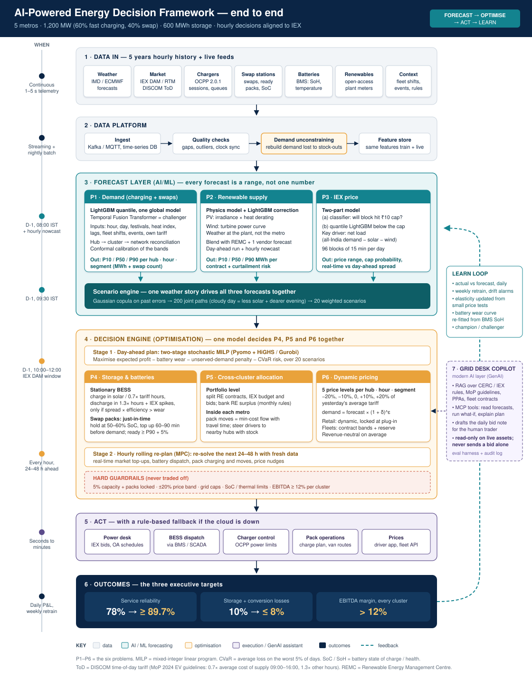
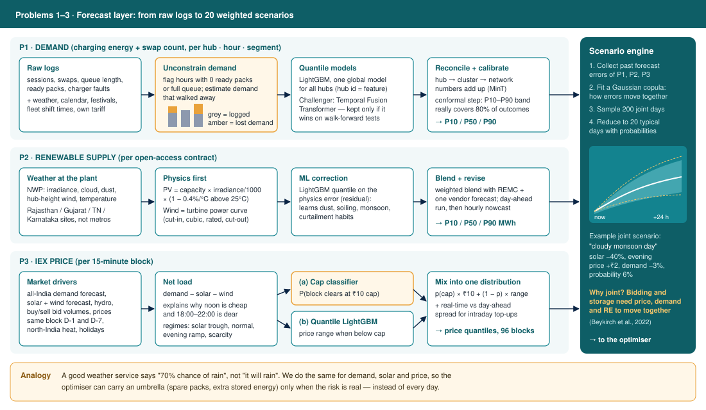
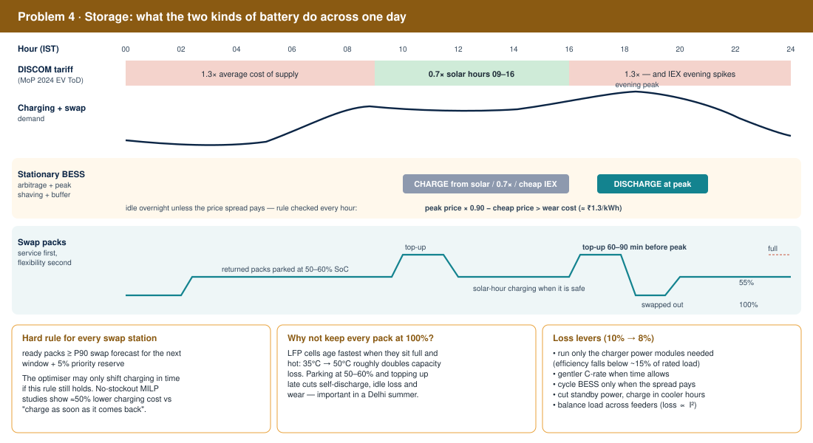
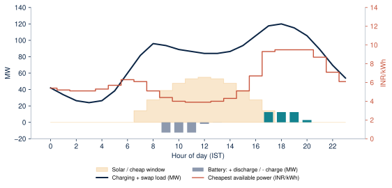
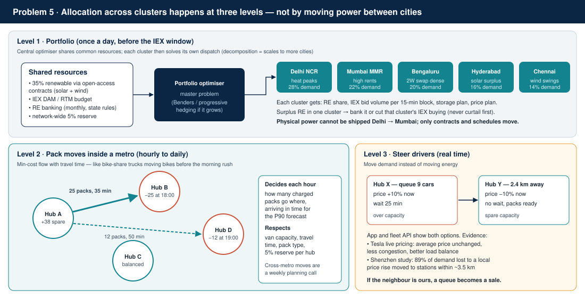
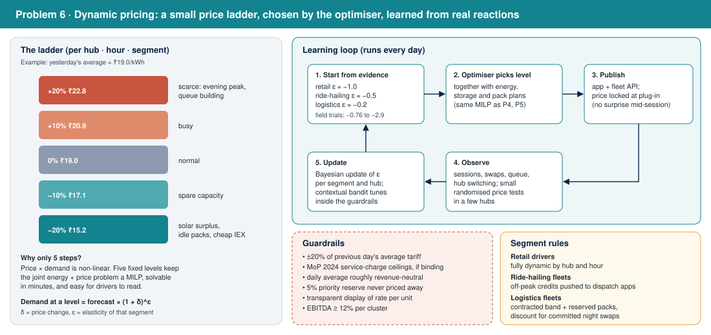
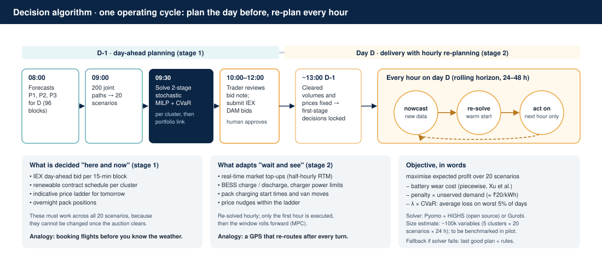
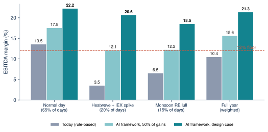
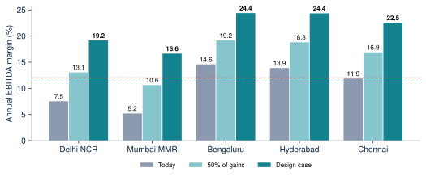
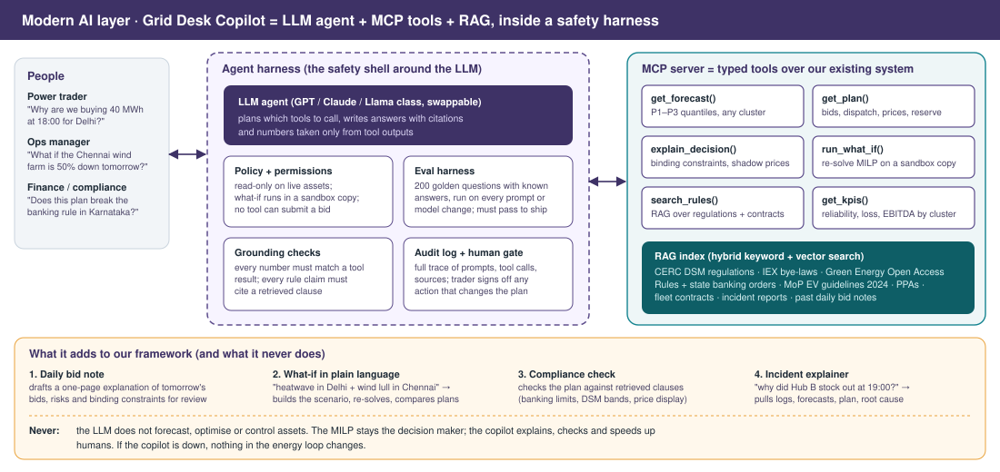

# AI Decision Framework for a National EV Charging and Battery-Swap Network

---

### Key results at a glance

| Executive target | Today | Design estimate | Conservative case (half the gains) |
|---|---|---|---|
| Service reliability | 78% | <mark>**90.0%**</mark> (target ≥ 89.7%) | 83.9% |
| Storage + conversion losses | 10% | <mark>**7.9%**</mark> (target ≤ 8%) | 9.0% |
| EBITDA margin, network | 10.4% | <mark>**21.3%**</mark> | 15.6% |
| EBITDA margin, weakest cluster | 5.2% (Mumbai) | <mark>**16.6%**</mark> (Mumbai) | 10.6% (Mumbai) |
| Annual EBITDA uplift | — | <mark>**+₹490 Cr**</mark> | +₹217 Cr |

> **How to read these numbers.** This is a case study, so nothing here is a test result. Every number comes from a transparent scenario model (`src/scenario_model.py`) built on stated assumptions (Section 9). The design choices themselves are not assumptions: each one copies a method that a named company already runs in production (Gogoro, NIO, Tesla, Fluence, Google DeepMind, Tata Power, Octopus Energy).

<div style="page-break-after: always;"></div>

## Contents

1. [Executive summary](#1-executive-summary)
2. [The challenge](#2-the-challenge)
3. [The solution at a glance](#3-the-solution-at-a-glance)
4. [Forecast layer: Problems 1–3](#4-forecast-layer-problems-13)
5. [Problem 4: Storage and battery optimisation](#5-problem-4-storage-and-battery-optimisation)
6. [Problem 5: Allocation across clusters](#6-problem-5-allocation-across-clusters)
7. [Problem 6: Dynamic pricing](#7-problem-6-dynamic-pricing)
8. [The quantitative model](#8-the-quantitative-model)
9. [Scenario model and economics](#9-scenario-model-and-economics)
10. [Modern AI layer: Grid Desk Copilot](#10-modern-ai-layer-grid-desk-copilot)
11. [Risks and safeguards](#11-risks-and-safeguards)
12. [Roadmap](#12-roadmap)
13. [Assumptions to verify](#13-assumptions-to-verify)
14. [References](#14-references)
15. [Image credits](#15-image-credits)
16. [Repository and how to reproduce](#16-repository-and-how-to-reproduce)

---

## 1. Executive summary

**The situation.** The operator runs 1,200 MW of charging capacity (60% DC fast charging, 40% battery swap) and 600 MWh of storage across five metros. 35% of its power comes from renewable open-access contracts; the rest comes from DISCOMs and the IEX day-ahead market. Today it delivers only 78% of the energy and swaps customers want, loses 10% of the energy it buys inside chargers and batteries, and some clusters earn below a 12% EBITDA margin.

**The root cause is not hardware. It is timing.** Packs are charged when they come back, not when power is cheap. Power is bought on single-number forecasts that miss heatwaves and cloudy days. Prices are flat, so every driver turns up at 7 pm. Surplus in one hub is not used to cover a shortage in the next.

**Our answer is one decision engine that runs on a fixed daily rhythm:**

1. **Forecast with ranges, not single numbers.** <mark>LightGBM quantile models</mark> forecast demand, renewable output and IEX prices as P10/P50/P90 ranges. A physics model handles the parts physics already explains (solar heat derating, turbine power curves). The three forecasts are then tied together into <mark>20 weighted weather scenarios</mark>, because a heatwave hits demand, solar and price on the same day.
2. **Decide everything together.** A <mark>two-stage stochastic MILP</mark> (mixed-integer linear program) sets tomorrow's IEX bids at 09:30, before the 10:00–12:00 auction window. On the day it re-plans every hour (rolling-horizon MPC) for battery dispatch, swap-pack charging, pack moves and prices.
3. **Protect the customer first.** Hard rules come before profit: ready packs ≥ P90 forecast + 5% reserve, prices within ±20% of yesterday's average, and grid connection limits.
4. **Learn every day.** Forecast errors and customer price responses feed back each night.
5. **Explain it to people.** A modern AI layer, the <mark>Grid Desk Copilot</mark> (an LLM agent with RAG and MCP tools inside a safety harness), drafts the daily bid note, runs what-if questions and checks compliance. It never places bids or controls assets.

**Why we believe it works without a test.** Each lever has a production precedent:

- NIO shifted swap-station charging off-peak and cut 44.7 GWh of peak-hour load in one year.
- Gogoro's SmartGEN forecasts swap demand for every station and pre-positions charged batteries.
- Tesla's live Supercharger pricing cut congestion at 550+ sites while keeping the average price flat.
- Fluence and Tesla bid batteries into power markets with probabilistic price forecasts and a built-in wear cost.
- A no-stockout swap-charging MILP cut energy cost by about 50% in a 30-day commercial replay.

**What it costs and returns.** About <mark>₹40 Cr to build</mark> and <mark>₹35 Cr a year to run</mark>. The design case adds about ₹490 Cr of EBITDA a year; even if only half the gains arrive, it still adds ₹217 Cr and pays back in under three months.

**The honest caveat.** The reliability target has a thin margin (90.0% vs 89.7%). It needs most of the planned levers to land. Section 9.6 shows what to do if it falls short: buy more swap packs for the worst hubs, which is a capex call rather than an algorithm change. <mark>Mumbai is the weakest cluster</mark> because of high rents. It clears 12% in the design case but not in the conservative case, so it gets targeted action (Section 9.5).

<div style="page-break-after: always;"></div>

## 2. The challenge

### 2.1 What has to be decided, every hour, for every cluster

| # | Problem | Decision it drives | Current pain |
|---|---|---|---|
| P1 | Demand forecasting | How much energy and how many swaps each hub will need | Some hubs run out of packs while others sit on idle stock |
| P2 | Renewable supply forecasting | How much of the 35% green power will actually arrive | Cloudy and low-wind days leave gaps; sunny days waste energy |
| P3 | IEX price forecasting | What to bid in the day-ahead market | Evening price spikes eat margin |
| P4 | Storage optimisation | When to charge and discharge 600 MWh of batteries and packs | Packs charged at peak, sit full in heat, age fast |
| P5 | Allocation across clusters | Where energy, packs and drivers should go | Surplus in one place is not used for deficit in another |
| P6 | Dynamic pricing | Price per cluster, hour and customer segment | Flat prices send everyone to the same peak hour |

### 2.2 Constraints that can never be broken

- Customer prices stay within <mark>±20% of the previous day's average tariff</mark>.
- <mark>5% of capacity (60 MW) and 5% of pack inventory</mark> stay uncommitted for priority fleets and emergencies.
- Grid connection limits per hub; 1,200 MW installed (720 MW fast charging, 480 MW swap); 600 MWh storage.
- Indian market rules: IEX day-ahead bids close by 12:00 on D-1, prices are capped at ₹10/kWh, and CERC deviation (DSM) rules apply.

### 2.3 How success is measured

| Metric | Definition | Today | Target |
|---|---|---|---|
| Service reliability | Energy + swaps delivered ÷ true demand | 78% | ≥ 89.7% |
| Losses | Energy lost in chargers, batteries, idle packs, cables ÷ energy bought | 10% | ≤ 8% |
| EBITDA margin | Per cluster, full year | below 12% in some clusters | > 12% in every cluster |

Supporting metrics we will report every day: forecast error (WAPE, pinball loss), swap stock-out rate, average queue time, renewable curtailment, battery cycles, wear cost per MWh, and average power cost per MWh.

---

## 3. The solution at a glance

<p align="center"></p>
<p align="center"><sub><b>Figure 0.</b> The full framework. Data flows down from sources to forecasts, scenarios, one decision engine and actions; outcomes flow back up as learning. The left rail shows when each step runs.</sub></p>

### 3.1 How one day runs

Think of it like an airline operations centre. The schedule is planned the day before, but the control room re-plans every hour as weather and bookings change.

| Time | What happens | Output |
|---|---|---|
| Continuous | Data flows in: sessions, swaps, queues, pack charge levels, weather, IEX results | Clean data in the feature store |
| D-1, 08:00 | Forecasts for tomorrow: demand (P1), renewables (P2), prices (P3) | P10/P50/P90 for every hub and hour |
| D-1, 09:00 | Scenario engine ties them together | 20 weighted joint scenarios |
| D-1, 09:30 | Stage 1 of the optimiser solves | Draft IEX bids, renewable schedule, price ladder, overnight pack positions |
| D-1, 10:00–12:00 | Trader reviews the bid note, approves, submits | IEX day-ahead bids |
| Day D, every hour | Stage 2 re-plans with fresh data | Battery dispatch, pack charging, van moves, price nudges |
| Seconds | Local controllers enforce limits | Charger power caps, safety trips |
| Nightly / weekly | Learning loop | Retrained models, updated price elasticities |

### 3.2 Three design principles

1. **Ranges beat single numbers.** The optimiser needs to know how bad a bad day can be, so it can hold spare packs only when the risk is real.
2. **One brain, not four.** Buying, storing, moving and pricing affect each other. Solving them separately leaves money on the table, so they sit in one optimiser.
3. **Rules first, profit second.** Customer service and the regulator's rules are hard constraints. The optimiser only looks for profit inside them.

<div style="page-break-after: always;"></div>

## 4. Forecast layer: Problems 1–3

<p align="center"></p>
<p align="center"><sub><b>Figure 1.</b> Three forecasting pipelines that share the same weather inputs and end in one scenario set.</sub></p>

**Analogy.** A good weather service says "70% chance of rain", not "it will rain". We do the same for demand, solar and price, so the optimiser can carry an umbrella (spare packs, stored energy) only on days that need one.

### 4.1 Problem 1: Demand forecasting

**What we forecast.** For each hub, hour and segment (retail, ride-hailing, logistics), two numbers:

- DC fast-charging energy (MWh), limited by charger power;
- swap count, limited by charged packs in stock (converted to MWh as swaps × pack size).

**Step 1: recover true demand (demand unconstraining).** The logs only show demand that was served. When a hub runs out of packs at 7 pm, the drivers who left are not in the data. A model trained on raw logs would learn today's 78% service level as if it were total demand, and reliability would never improve.

*Analogy:* a shop that only counts sales will think nobody wants umbrellas on the days it ran out of umbrellas. Airlines and retailers fix this with a standard step called unconstraining.

```text
for each hub, hour:
    if ready_packs == 0 or queue_full or charger_fault:
        mark hour as "constrained"
        lost = estimate from (time of stock-out, queue abandonment, app searches)
        true_demand = served + lost
    else:
        true_demand = served
train forecast models on true_demand
```

**Step 2: the model.**

- **Main model:** one global <mark>LightGBM quantile model</mark> for all hubs (P10, P50, P90). The hub ID is a feature, so small hubs borrow patterns from busy ones.
- **Challenger:** a Temporal Fusion Transformer (TFT). It replaces LightGBM only if it wins on walk-forward tests.
- **Features:** hour, weekday, festivals, IPL nights; heat (cooling degree hours above 34 °C, because air conditioning drains EV batteries); rain; same hour yesterday and last week; fleet shift times; growth trend; our own tariff.
- **Make the levels add up:** MinT reconciliation adjusts hub forecasts so they sum exactly to cluster and network totals. The cluster number drives buying power; the hub number drives pack positioning.
- **Make the ranges honest:** conformal calibration checks that the P10–P90 band really contains about 80% of outcomes, and widens it if not.

**Why LightGBM and not deep learning first?** Gradient boosting won the M5 forecasting competition and led the GEFCom2014 probabilistic load track. A 2026 study of EV charging demand under rolling-origin evaluation found XGBoost the most accurate, with LSTM no better. It is also explainable and fast to retrain.

**Evidence from industry**

- **Gogoro SmartGEN** tracks 60+ live inputs per station (battery state, rider behaviour, traffic, weather), forecasts swap demand and peak riders, then schedules charging and positions packs before demand arrives.
- **Tata Power** runs an EV load forecasting tool on 3 million EZ Charge sessions for real-time grid balancing.
- **Research:** forecasting total load across many fast chargers is much more accurate than for a single station (about 5% error across 244 stations on Jeju Island).

<p align="center"></p>
<p align="center"><sub><b>Reference image 1.</b> Gogoro's swap network, where SmartGEN forecasts demand per station and pre-positions charged batteries. <i>Source: Gogoro, "Think Deeper: SmartGEN network management", gogoro.com/news/think-deeper-smartgen-network-management.</i></sub></p>

### 4.2 Problem 2: Renewable supply forecasting

**The easy-to-miss point.** Open-access solar and wind plants are not in the metros. They are in Rajasthan, Gujarat, Tamil Nadu and Karnataka. So we use <mark>weather at the plant</mark>, not in Delhi or Mumbai, and map each contract to the cluster it serves.

**Model: physics first, machine learning second.**

- **Solar** (simple physics):

  ```text
  solar output = capacity × (irradiance / 1000) × (1 − 0.4% for every °C the panel is above 25 °C)
  ```

  This captures why a 45 °C Rajasthan afternoon produces less than a cool sunny morning.
- **Wind:** the turbine's power curve. Zero below cut-in speed, rising steeply up to rated speed, flat at rated, zero above cut-out.
- **ML correction:** LightGBM quantile models learn what physics misses: dust, soiling, monsoon cloud, and the plant's curtailment habits.
- **Blend:** combine our forecast with the grid operator's REMC forecast and one commercial vendor. India's REMCs already blend three providers this way.

*Analogy:* physics is the recipe, ML is the experienced cook who knows this oven runs hot.

**Two runs, two outputs.** A day-ahead run before the IEX window, and an hourly nowcast for real-time top-ups. Outputs: available renewable energy as P10/P50/P90, and the chance of curtailment. Contracted volume and physically available volume are kept separate, because take-or-pay terms depend on the gap.

**Evidence from industry**

- **Google DeepMind** forecast 700 MW of wind output 36 hours ahead and committed hourly delivery a day in advance. Google reported about 20% more value, though against a weak baseline of no commitments.
- **Tata Power** uses AI solar forecasts with sky cameras and weather feeds to cut deviation penalties.
- **CERC's DSM regulations** charge for deviations from schedule, so better forecasts have direct cash value.

<p align="center"></p>
<p align="center"><sub><b>Reference image 2.</b> DeepMind's predicted versus actual wind output over three days, used to recommend day-ahead commitments to the grid. <i>Source: Google DeepMind blog, "Machine learning can boost the value of wind energy" (2019), deepmind.google/blog/machine-learning-can-boost-the-value-of-wind-energy.</i></sub></p>

### 4.3 Problem 3: IEX price forecasting

**What we forecast.** The day-ahead clearing price for each of the 96 fifteen-minute blocks, plus the expected gap between real-time and day-ahead prices.

**Why two models.** IEX prices are capped at ₹10/kWh, and on hot evenings many blocks clear right at the cap. A 2026 study of IEX's Green Day-Ahead Market found tree models most accurate, but <mark>every model under-predicted near the cap</mark>. So we split the job:

1. A **cap classifier** predicts the probability a block clears at ₹10.
2. A **quantile LightGBM** predicts the price range when it doesn't.

```text
expected price = P(cap) × 10 + (1 − P(cap)) × price_below_cap
```

**The main driver is net load:** all-India demand minus solar minus wind. It explains why noon is cheap (solar floods the grid) and 18:00–22:00 is expensive (solar is gone, air conditioners are still on). Other features: same block yesterday and last week, buy/sell bid volumes, hydro and monsoon, north-India heat, holidays.

*Analogy:* like surge pricing for cabs. Price climbs when demand stays high but supply drops off, which happens every evening as solar fades.

**Evidence from industry.** **Fluence Mosaic**, used by PG&E for its 183 MW / 730 MWh Elkhorn battery, forecasts a full price distribution and bids within a risk limit set by human traders. A California regulator's filing confirms its use and notes weakness on extreme-price days, which is exactly what our cap classifier targets. **Tesla Autobidder** puts price forecasting first in the same way.

### 4.4 Linking the three: joint scenarios

A cloudy monsoon day lowers solar, raises evening prices and changes demand, all at once. If the three forecasts were sampled separately, the optimiser would think the bad combinations are rare and under-prepare.

```text
fit a Gaussian copula on past forecast errors of (demand, solar, wind, price)
draw 200 joint paths for tomorrow (each a full 24-hour story)
reduce to 20 representative scenarios, each with a probability
hand them to the optimiser
```

*Example scenario:* "Cloudy monsoon Tuesday, probability 6%: solar −35%, evening price +₹1.8, Chennai swap demand −8%."

**Why this is not over-engineering.** Beykirch et al. (2022) show that bidding and storage scheduling need joint forecast distributions, while simple scheduling can live with averages. We do both, so joint scenarios are justified.

### 4.5 What the forecast layer hands to the optimiser

For each cluster and hour, over the next 24–48 hours:

- demand P10/P50/P90 (charging MWh and swap count, by segment);
- renewable P10/P50/P90 and curtailment probability;
- price quantiles per 15-minute block, cap-hit probability, real-time gap;
- 20 joint scenarios with weights.

**Accuracy we aim for**, quoted from published studies as benchmarks, not our results: about 6–8% day-ahead error for cluster demand (about 15% for single hubs), 5–8% of capacity for solar, and 5–18% MAPE for IEX prices depending on season.

<div style="page-break-after: always;"></div>

## 5. Problem 4: Storage and battery optimisation

<p align="center"></p>
<p align="center"><sub><b>Figure 2.</b> What the two kinds of battery do across one day under the 2024 time-of-day tariff.</sub></p>

### 5.1 The key insight: two different batteries, two different jobs

The 600 MWh is split, by our assumption, into about 250 MWh of stationary batteries and about 350 MWh of swap packs. They need different rules.

| | Stationary batteries | Swap packs |
|---|---|---|
| Main job | Buy cheap, use expensive; shave hub peaks; buffer | Be charged and ready when a rider arrives |
| Priority | Profit, within wear limits | Service first, flexibility second |
| Decision | Charge or discharge, how much, each hour | When to start charging each returned pack |

### 5.2 A gift from regulation: the 2024 time-of-day tariff

India's 2024 EV charging guidelines set DISCOM tariffs for charging stations at <mark>0.7× the average cost of supply during solar hours (09:00–16:00) and 1.3× at other times</mark>. That spread exists even without IEX, so midday charging pays at every hub, including small hubs that cannot use open access.

### 5.3 Stationary batteries: cycle only when it pays

Every full cycle wears the battery. So the battery cycles only if the price gap beats both the energy lost and the wear:

```text
cycle only if:   peak price × 0.90 (round-trip efficiency) − cheap price  >  wear cost per kWh
```

The wear cost comes from Xu et al.'s piecewise cycle-ageing model, which charges more for deep cycles than shallow ones and fits straight into a MILP.

*Analogy:* a taxi driver doesn't take a long trip for a tiny fare, because the wear on the car costs more than the fare.

**Worked example.** Solar-hour price ₹4.0, evening IEX price ₹9.5, wear ₹1.3/kWh: 9.5 × 0.9 − 4.0 = ₹4.55 > ₹1.3, so cycle. On a monsoon day with ₹6.5 midday and ₹7.5 evening: 7.5 × 0.9 − 6.5 = ₹0.25 < ₹1.3, so stay idle.

<p align="center"></p>
<p align="center"><sub><b>Figure 3.</b> Illustrative one-cluster day (50 MWh / 12.5 MW battery): charge in the cheap solar window, discharge into the evening peak, idle overnight because the spread doesn't cover wear.</sub></p>

### 5.4 Swap packs: just-in-time charging

Today packs are charged the moment they come back. That means peak-price charging, and packs sitting at 100% in 40 °C heat, which is the fastest way to age LFP cells (going from 35 °C to 50 °C roughly doubles capacity loss).

**New rule:** park returned packs at 50–60%, charge in cheap hours where possible, and top up to full 60–90 minutes before forecast demand.

```text
every hour, for each swap station s:
    need = P90 swap forecast for next window + 5% reserve
    if ready_packs(s) < need:
        charge enough packs now (hard rule, ignore price)
    else:
        choose start times for the rest to minimise:
            energy cost + wear cost + idle loss
        keep parked packs at 50–60% SoC until their top-up slot
```

*Analogy:* a bakery that bakes just before the morning rush instead of the night before, so the bread is fresh and the ovens run on cheap power.

**Evidence.** A no-stockout swap-charging MILP cut charging energy cost by <mark>about 50% with zero stock-outs</mark> in a 30-day replay at a commercial station. NIO's cloud system plans each station's charging from demand and price forecasts; in its 2023 report, 977 stations shifted 44.7 GWh out of peak hours. Swaps still took about three minutes when stations cut power on grid request.

<p align="center"></p>
<p align="center"><sub><b>Reference image 3.</b> A NIO Power Swap Station. NIO's stations plan pack charging around demand and city power prices, and act as grid-flexible loads. <i>Source: CnEVPost, "Power crunch: How NIO's swap stations help reduce grid peak load" (Aug 2022), cnevpost.com; photo: NIO.</i></sub></p>

### 5.5 Losses: from 10% to 8%

Losses are physical, so each lever is physical:

| Lever | What changes | Est. saving (pts) |
|---|---|---|
| Charger module staging | Run only as many power modules as needed, so each stays near ~96% efficiency (efficiency drops sharply below ~15% load, per NREL) | 0.6 |
| Just-in-time pack charging | Fewer hours at full charge, less self-discharge and cooling | 0.5 |
| Cycle batteries only when it pays | Fewer round trips at 90% efficiency | 0.4 |
| Feeder load balancing | Spread load across transformers, lower cable losses | 0.3 |
| Standby and thermal management | Sleep idle chargers (~600 W each), charge in cooler hours | 0.3 |
| **Total** | | <mark>**2.1 → 7.9%**</mark> |

<p align="center"></p>
<p align="center"><sub><b>Figure 4.</b> Loss waterfall: design estimate per lever (assumptions, not measured).</sub></p>

<!-- OPTIONAL REFERENCE IMAGE: NREL charger efficiency curve
     Download: Figure on DC charger efficiency vs. power level in NREL "EVs@Scale charger characterization" (docs.nlr.gov/docs/fy25osti/93967.pdf)
     Save as:  assets/refs/nrel_charger_efficiency.png, then uncomment:
<p align="center"></p>
<p align="center"><sub>DC fast-charger efficiency falls sharply at low load. Source: NREL, EVs@Scale (2024).</sub></p>
-->

### 5.6 The 5% reserve

60 MW of power and 5% of packs in every cluster are locked as untouchable. When forecasts are more uncertain (a wide P10–P90 band), the optimiser can hold more, but never less than 5%. Later, the same flexibility can earn grid-services revenue, as Gogoro and NIO already do.

<p align="center"></p>
<p align="center"><sub><b>Reference image 4.</b> Taiwan's grid, where about 1,000 Gogoro swap stations in Enel X's virtual power plant paused charging within 5 seconds (11 MW) in April 2024, with riders still served first. <i>Source: Enel X Taiwan, "Reinforcing grid resilience with VPPs", enelx.com/tw/en/resources/reinforcing-grid-resilience-with-vpps.</i></sub></p>

<div style="page-break-after: always;"></div>

## 6. Problem 5: Allocation across clusters

<p align="center"></p>
<p align="center"><sub><b>Figure 5.</b> Allocation happens at three levels, not by moving power between cities.</sub></p>

### 6.1 The reframe

<mark>Electricity cannot be shipped from Delhi to Mumbai.</mark> The power grid and open-access rules decide where energy can flow. So "cross-cluster allocation" really means three things.

### 6.2 Level 1: Portfolio, once a day

One central optimiser shares the common resources before the IEX window: the 35% renewable contracts, the IEX budget, renewable banking, and the network-wide reserve. Each cluster then solves its own dispatch.

- Surplus renewable energy in one cluster is **banked** (Green Energy Open Access Rules 2022 allow monthly banking, at least 30% of monthly consumption, with state variations) or used to **cut that cluster's IEX purchase**, instead of being curtailed.
- The split into one master problem plus five cluster problems is a standard decomposition (Benders or progressive hedging). It is also how the system scales to a sixth or tenth city.

*Analogy:* a family budget. One person decides how much each household member can spend; each person then plans their own week.

### 6.3 Level 2: Pack moves inside a metro, hourly to daily

Moving charged packs between hubs is the same problem bike-share operators solve every night.

```text
packs at hub s next hour = packs now
                         − swaps
                         + packs finished charging
                         + packs arriving from other hubs (sent τ minutes ago)
                         − packs sent out
```

A min-cost flow model picks which van moves how many packs where, so they arrive before the P90 forecast says they're needed. It respects van capacity, travel time, pack type, and the 5% reserve per hub. Moves between metros are a weekly planning call, not hourly.

*Analogy:* Citi Bike trucks moving bikes to commuter stations before the morning rush. Cornell's optimisation for Citi Bike cut expected customer dissatisfaction by a further 12% over the operator's own method.

### 6.4 Level 3: Steer drivers, not energy

Sometimes the cheapest "move" is the customer. If Hub X has a 25-minute queue and Hub Y, 2 km away, has free chargers, the app shows Hub X at +10% and Hub Y at −10%.

**Evidence.** Tesla's live Supercharger pricing lowered congestion and raised use at quieter sites. In Shenzhen, <mark>89% of the demand lost to a local price rise moved to stations within about 3.5 km</mark>, rather than disappearing.

### 6.5 Constraints

- Each hub's sanctioned grid connection limit.
- Each cluster's 5% reserve.
- Open-access eligibility: buying from IEX via open access usually needs about 1 MW or more of connected load (state rules vary). Smaller hubs stay on the DISCOM time-of-day tariff.

<div style="page-break-after: always;"></div>

## 7. Problem 6: Dynamic pricing

<p align="center"></p>
<p align="center"><sub><b>Figure 6.</b> A small price ladder chosen by the optimiser, and a daily learning loop with guardrails.</sub></p>

### 7.1 A five-step price ladder

```text
price = yesterday's average tariff × (1 + step)
step ∈ { −20%, −10%, 0, +10%, +20% }
```

At a ₹19.0/kWh average: ₹15.2 · ₹17.1 · ₹19.0 · ₹20.9 · ₹22.8.

**Why only five steps?** Price × demand is non-linear. Five fixed levels keep the whole energy-plus-price problem a MILP, solvable in minutes, and easy for drivers to read. The ±20% band is built into the ladder itself, so it can never be breached.

### 7.2 How demand reacts

```text
demand at a price step = forecast at normal price × (1 + step) ^ elasticity
```

**Example.** Retail elasticity −1.0, step −10% in the solar window: demand × 0.9^(−1.0) ≈ +11%. Step +10% at 19:00: demand × 1.1^(−1.0) ≈ −9%, and most of that moves to a nearby hub or a cheaper hour.

| Segment | Elasticity prior | Basis |
|---|---|---|
| Retail drivers | <mark>−1.0</mark> (tested from −0.6 to −2.0) | UK trial of 110,000 drivers (−1 to −1.45 net), Germany −1.79, Shenzhen −0.76 |
| Ride-hailing | about −0.5 | Assumption: time-pressed but cost-aware |
| Logistics fleets | about −0.2 | Assumption: mostly on contract |

The four AI drafts we reviewed assumed much lower elasticities. Field trials show EV drivers are more price-sensitive than that, which makes pricing a stronger lever than expected.

### 7.3 Segment rules

- **Retail:** dynamic price per hub and hour, <mark>locked when the driver plugs in</mark> (Tesla's rule), so nobody is surprised mid-session.
- **Fleets:** contracted price bands with off-peak discounts, plus guaranteed access to the 5% priority reserve.
- **Swaps:** a price per swap, or subscription credits for off-peak swaps.

### 7.4 Guardrails

- ±20% of the previous day's average tariff, always.
- MoP 2024 service-charge ceilings (₹11 solar hours, ₹13 other hours for DC fast charging), if they apply to us.
- Daily average price stays close to yesterday's. The goal is to move demand, not to gouge.
- The 5% priority reserve is never priced away.
- Transparent display of the rate per unit, as the guidelines require.
- No cluster price plan may push that cluster's EBITDA below 12%.

### 7.5 The learning loop

```text
start with elasticity priors from published trials
every night:
    observe sessions, swaps, hub switching at each price step
    in a few shadow hubs, randomise the price step (small, within ±10%)
    Bayesian update of elasticity per segment and hub
    contextual bandit picks among allowed steps, inside the optimiser's guardrails
```

*Analogy:* a chef adjusting the menu price of one dish in one restaurant for a week before changing it across the chain.

**Evidence.** Tesla's live pricing covered 550+ US sites by November 2025 with the average price unchanged, fewer sessions paying peak prices, and less congestion. Octopus Energy's AI-managed tariff cut household peak demand by 42% in a randomised NBER study, with only about 1% of customers overriding it on a given day.

<p align="center"></p>
<p align="center"><sub><b>Reference image 5.</b> A Tesla Supercharger site. Tesla's live pricing raises prices as a site gets busy and points drivers to quieter sites nearby. <i>Source: Not a Tesla App, "Tesla adds dynamic Supercharger pricing to 550 locations" (Nov 2025), notateslaapp.com/news/3330; photo: Tesla.</i></sub></p>

<div style="page-break-after: always;"></div>

## 8. The quantitative model

<p align="center"></p>
<p align="center"><sub><b>Figure 7.</b> The algorithm: plan the day before (stage 1), re-plan every hour on the day (stage 2).</sub></p>

### 8.1 Plain-language summary

The optimiser is a **two-stage stochastic MILP with a CVaR risk term**, solved with Pyomo and HiGHS (open source) or Gurobi.

- **Two-stage** means some decisions are locked before uncertainty is known (IEX bids), and others adapt once it is (battery dispatch).
- **Stochastic** means it plans across the 20 scenarios at once, not just the average day.
- **MILP** means some decisions are yes/no (charge or discharge, which price step), which a linear solver handles exactly.
- **CVaR** (conditional value at risk) means the average loss on the worst 5% of days. Adding it to the objective stops the plan from betting the margin on a lucky day.

### 8.2 Building blocks

| Element | Meaning |
|---|---|
| **Sets** | clusters c, hubs h, hours t (24–48), 15-minute IEX blocks b, scenarios s (20), segments k |
| **Stage 1 decisions** | IEX bid per block and cluster; renewable schedule per contract; price step per hub, hour, segment; overnight pack positions |
| **Stage 2 decisions** (per scenario) | real-time market top-up; battery charge and discharge; pack charging starts; van moves; unmet demand |
| **Inputs** | forecasts and scenarios from Section 4; tariffs; battery specs; grid limits; wear curve |

### 8.3 Objective, in words

```text
maximise   Σ over scenarios  probability × (revenue − power cost − battery wear − penalty × unmet demand)
           − λ × CVaR (average loss on the worst 5% of scenarios)
```

The penalty on unmet demand (about ₹20/kWh, above the tariff) is what makes reliability a priority: the optimiser would rather pay for spare packs than leave a rider without one.

### 8.4 Constraints, in words

| # | Constraint | Simple form |
|---|---|---|
| 1 | Energy balance per cluster, hour, scenario | bought + renewable + battery discharge = served demand + battery charge + losses |
| 2 | Battery charge level | next SoC = current SoC + charge × efficiency − discharge ÷ efficiency |
| 3 | Battery limits | 10% ≤ SoC ≤ 95%; charge and discharge never at the same time (binary) |
| 4 | Swap readiness | ready packs ≥ P90 swap forecast + 5% of packs |
| 5 | Pack flow | packs next hour = now − swaps + recharged + arriving − leaving (Section 6.3) |
| 6 | Grid limit | hub load ≤ sanctioned connection, minus 5% reserve |
| 7 | Price band | price step ∈ {−20, −10, 0, +10, +20%} |
| 8 | Demand response | demand = forecast × (1 + step) ^ elasticity |
| 9 | Losses | total losses ÷ energy bought ≤ 8% (monitored; a soft target with a penalty) |
| 10 | Renewable rules | banking ≤ state limit; RE share ≥ 35% over the month |
| 11 | Non-anticipativity | stage 1 decisions are the same in every scenario |

### 8.5 The daily loop in pseudo code

```text
# ---------- D-1 ----------
08:00  F = forecast(demand, solar, wind, price, horizon = 48h)        # P10/P50/P90
09:00  S = scenarios(F, copula, n_paths = 200, keep = 20)              # weighted
09:30  plan = solve_stage1_MILP(S, guardrails)                         # per cluster + portfolio link
       if solver fails or timeout: plan = last_good_plan + rules
       note = copilot.draft_bid_note(plan)                             # explanation only
10:00  trader reviews note, approves bids  →  submit to IEX DAM
13:00  load cleared volumes and prices; lock stage 1

# ---------- Day D, every hour ----------
loop each hour t:
    update nowcasts (demand, renewables, real-time price)
    plan_t = solve_stage2_MILP(window = t … t+24h, warm_start = previous plan)
    execute only hour t:
        battery set-points, pack charging starts, van tasks, price steps
    local controllers enforce power caps and safety in seconds

# ---------- Night ----------
log actuals; unconstrain demand; retrain models weekly
update elasticities (Bayesian); recalibrate conformal bands
report KPIs per cluster
```

### 8.6 Can it solve in time?

The full problem has roughly 100,000 variables (5 clusters × 20 scenarios × 24 hours × hubs and blocks). That size is routine for HiGHS or Gurobi, and decomposing by cluster keeps each piece small. The real solve time is an item to benchmark in the shadow phase. The fallback, last good plan plus simple rules, means the network never stops if the solver is slow.

<div style="page-break-after: always;"></div>

## 9. Scenario model and economics

### 9.1 Why a scenario model and not a backtest

We cannot run the system, so we built a transparent assumption model instead. It takes each design lever, assumes what it changes (reliability, losses, power cost), and turns that into revenue and EBITDA under three kinds of day. Every input is in one file, `src/scenario_model.py`, so a reviewer can change any assumption and rerun.

### 9.2 Key assumptions

| Assumption | Value | Basis |
|---|---|---|
| True demand | 6,000 MWh/day normal (6,900 heatwave, 5,800 monsoon) | ~21% utilisation of 1,200 MW, typical for urban public charging |
| Blended tariff | ₹19/kWh (DC ~₹17, swap-equivalent ~₹22) | Indian public DC and swap price ranges |
| Power cost per kWh bought | ₹6.6 normal, ₹8.4 heatwave, ₹7.4 monsoon (baseline) | Mix of DISCOM ToD, IEX ₹3–10, renewable PPAs |
| Optimised power cost | ₹5.95 / ₹7.30 / ₹6.50 | More solar-hour buying, less curtailment, fewer peak purchases |
| Variable non-energy cost | ₹2.6/kWh delivered | Site host share, payments, variable O&M |
| Battery wear cost | ₹1.00 → ₹0.85/kWh delivered | Fewer deep cycles, less heat exposure |
| Fixed cost | ₹2.65 Cr/day | Leases, staff, fixed DISCOM charges |
| AI system | ₹40 Cr one-time, ₹35 Cr/year | Platform, team, data, extra van logistics |
| Average realised price | +1% normal, +6% heatwave, +2% monsoon | More peak sessions at +10/20% steps; well inside ±20% |
| Day mix | 65% normal, 20% heatwave + IEX spike, 15% monsoon RE lull | Indian seasonal pattern |

### 9.3 Results by type of day

| Type of day | Share | Reliability (today → design) | Losses | EBITDA margin |
|---|---|---|---|---|
| Normal day | 65% | 80.0% → 91.0% | 9.7% → 7.7% | 13.5% → <mark>22.2%</mark> |
| Heatwave + IEX spike | 20% | 72.5% → 87.5% | 11.0% → 8.6% | 3.5% → <mark>20.6%</mark> |
| Monsoon renewable lull | 15% | 77.0% → 89.5% | 10.1% → 7.9% | 6.5% → <mark>18.5%</mark> |
| **Full year** | | **77.9% → 90.0%** | **10.0% → 7.9%** | **10.4% → 21.3%** |

The biggest gain is on heatwave days. Today those days nearly wipe out margin, because demand peaks exactly when packs run out and IEX hits its cap. The probabilistic forecast sees them coming, buys ahead, pre-charges in the morning solar window, and steers drivers away from overloaded hubs.

<p align="center"></p>
<p align="center"><sub><b>Figure 8.</b> EBITDA margin by type of day, today versus design.</sub></p>

### 9.4 Where the reliability gain comes from

| Lever | Points | How |
|---|---|---|
| Fewer pack stock-outs | +3.6 | Just-in-time charging with the P90 + 5% readiness rule, plus pack moves |
| Fewer energy shortfalls | +3.4 | Probabilistic bids and stored energy for evening peaks |
| Fewer abandoned queues | +2.0 | Price steering to nearby hubs |
| Fewer grid-cap hours | +1.6 | Battery peak shaving under connection limits |
| Less charger downtime | +1.4 | Predictive fault alerts from charger telemetry |
| **Total** | **+12.0 → <mark>90.0%</mark>** | |

<p align="center"></p>
<p align="center"><sub><b>Figure 9.</b> Reliability bridge from 78% to the design estimate.</sub></p>

### 9.5 Every cluster above 12%?

| Cluster | Today | Design | Conservative (half the gains) |
|---|---|---|---|
| Delhi NCR | 7.5% | 19.2% | 13.1% |
| Mumbai MMR | 5.2% | 16.6% | <mark>10.6%</mark> |
| Bengaluru | 14.6% | 24.4% | 19.2% |
| Hyderabad | 13.9% | 24.4% | 18.8% |
| Chennai | 11.9% | 22.5% | 16.9% |

<p align="center"></p>
<p align="center"><sub><b>Figure 10.</b> EBITDA margin by cluster against the 12% floor.</sub></p>

**All five clusters clear 12% in the design case.** In the conservative case, <mark>Mumbai is the one exception</mark>, because its site rents are about 12% above average. The plan for Mumbai:

- start the pilot there, so it gets the gains first;
- push fleet contracts with off-peak commitments (fleets are less price-sensitive, so off-peak discounts cost less);
- renegotiate host revenue shares at the lowest-use sites, or close them.

Delhi is the second watch item: it has the most heatwave days, so it gains the most but also carries the most weather risk.

### 9.6 What if the gains are smaller?

<p align="center"></p>
<p align="center"><sub><b>Figure 11.</b> Full-year EBITDA margin under stress, against the 12% floor.</sub></p>

| Stress test | Network EBITDA margin |
|---|---|
| Design case | 21.3% |
| Losses stuck at 8.5% | 21.1% |
| Average tariff −5% | 17.2% |
| Only 50% of gains realised | <mark>15.6%</mark> |
| Power cost +20% | 14.3% |

The network margin stays above 12% in every stress test. The margin target is robust.

**The reliability target is not.** It needs about 97% of the planned levers to land (90.0% vs 89.7%). With half the gains, reliability reaches 83.9%. This gap is the most important thing for management to know. If the shadow phase shows reliability tracking below plan, the fix is physical: add swap packs at the 10–15% of hubs with the most stock-outs. The optimiser already tells us which hubs those are, because the readiness constraint binds there first.

### 9.7 Cost and payback

| Item | Value |
|---|---|
| One-time build (data platform, models, optimiser, integration) | ₹40 Cr |
| Running cost (team, cloud, data, extra van logistics) | ₹35 Cr/year (already inside the EBITDA figures) |
| EBITDA uplift, design case | <mark>₹490 Cr/year</mark> |
| EBITDA uplift, conservative case | ₹217 Cr/year |
| Payback | ~1 month (design), ~2.2 months (conservative) |
| Revenue | ₹3,322 Cr → ₹3,924 Cr (mostly from serving demand that walks away today) |

Most of the uplift comes from **serving more demand on the same assets** (1,748 → 2,020 GWh a year), not from raising prices. Fixed costs are spread over more energy, which is why margin rises faster than revenue.

### 9.8 Scalability

- **More clusters:** each new city adds one cluster subproblem; the portfolio master problem grows only by one link. Solve time grows roughly linearly.
- **More hubs:** the global LightGBM model learns a new hub from day one using similar hubs' patterns; it does not need a year of history.
- **More storage or renewables:** extra rows and columns in the same MILP; no redesign.
- **Fallback:** if any model or solver fails, the last good plan plus simple rules keeps the network running.

<div style="page-break-after: always;"></div>

## 10. Modern AI layer: Grid Desk Copilot

### 10.1 Can modern AI plug in directly?

**Yes, in two places, as upgrades rather than replacements:**

1. **Time-series foundation models** (Amazon Chronos, Google TimesFM) can join the forecast layer as challengers to LightGBM. Their real value here is the <mark>cold-start problem</mark>: a new hub with two weeks of data gets a sensible forecast from day one. They go through the same walk-forward gate as the TFT.
2. **AI weather models** (ECMWF's AIFS, Google's GraphCast) can be extra weather inputs for the solar and wind forecasts, alongside conventional weather forecasts.

**No, in the decision itself.** An LLM should not decide how much power to buy or when to discharge a battery. Those decisions need exact arithmetic, hard constraints and audit trails, which the MILP provides and an LLM does not.

### 10.2 The one practical feature we add

The gap in the framework is not prediction or optimisation. It is the **people around it**. A trader must understand and approve tomorrow's bids within a two-hour IEX window. An ops manager wants to ask "what if the Chennai wind farm is down tomorrow?" without waiting for a data scientist. Compliance must check the plan against dozens of state banking orders and CERC rules.

<p align="center"></p>
<p align="center"><sub><b>Figure 12.</b> Grid Desk Copilot: an LLM agent that calls typed MCP tools over the existing system and retrieves rules through RAG, all inside a safety harness.</sub></p>

**How it is built**

| Component | Role |
|---|---|
| **LLM agent** | Understands the question, decides which tools to call, writes an answer with citations. Model is swappable. |
| **MCP server** (Model Context Protocol) | Exposes our system as typed tools: `get_forecast`, `get_plan`, `explain_decision`, `run_what_if`, `search_rules`, `get_kpis`. |
| **RAG index** (retrieval-augmented generation) | Hybrid keyword and vector search over CERC DSM regulations, IEX bye-laws, Green Energy Open Access rules and state banking orders, MoP EV guidelines, PPAs, fleet contracts and past bid notes. |
| **Harness** (the safety shell) | Read-only permissions on live assets; what-if runs on a sandbox copy; grounding checks that every number came from a tool and every rule claim cites a clause; an eval set of 200 known-answer questions run on every change; a full audit log. |

**What it does, with examples**

1. **Daily bid note.** At 09:35 it drafts one page: "Tomorrow we buy 18% more in blocks 69–80 for Delhi because the P90 demand is 11% above normal (heat index 44 °C) and the cap-hit probability is 62%. Binding constraint: Hub DL-14 pack readiness."
2. **What-if in plain language.** "Heatwave in Delhi plus a wind lull in Chennai" → builds the scenario, reruns the MILP in the sandbox, compares cost and reliability against today's plan.
3. **Compliance check.** "Does this plan break Karnataka's banking limit?" → retrieves the clause, checks the plan's banked volume, answers with the citation.
4. **Incident explainer.** "Why did Hub B stock out at 19:00?" → pulls the forecast, the plan, the actuals and the van log, and explains the root cause.

*Analogy:* a sharp analyst on the trading desk who has read every regulation and can rerun the model in seconds, but has no authority to sign anything.

### 10.3 What it never does

The copilot <mark>never forecasts, never optimises and never controls assets</mark>. No tool it can call submits a bid or moves a battery. If it goes down, nothing in the energy loop changes. A human signs off any action that changes the plan.

### 10.4 How we know it helps

- Time for the trader to review and approve bids (target: under 20 minutes inside the two-hour window).
- Share of answers that pass grounding checks (target: 100% of numbers traceable to a tool).
- Compliance issues caught before submission.
- Eval-set score must not drop on any model or prompt change before release.

<div style="page-break-after: always;"></div>

## 11. Risks and safeguards

| Risk | What could go wrong | Safeguard |
|---|---|---|
| Forecast miss on an extreme day | A record heatwave sits outside the training data | P90 readiness rule, CVaR term, 5% reserve never touched, conformal bands widen after misses |
| Elasticity is wrong | Drivers react less (or more) than assumed | Start with ±10% steps in a few hubs; Bayesian updates; full ±20% only after evidence |
| Solver slow or fails | No plan by 10:00 | Time limit, warm start, last good plan + rules fallback |
| Regulatory change | Ceilings, DSM bands or banking rules change | Rules are parameters, not code; copilot flags new circulars |
| Data quality | Missing telemetry, wrong pack charge levels | Quality checks before the feature store; hubs with bad data fall back to rules |
| Customer trust | "Surge pricing" backlash | Price locked at plug-in, transparent display, average near yesterday's, fleets on contracts |
| Battery ageing faster than modelled | Wear cost underestimated | Track state of health monthly; update the wear curve; the cycling rule tightens automatically |
| Over-reliance on AI | Staff stop questioning the plan | Trader approval for bids, daily KPI review, copilot explains rather than decides |

---

## 12. Roadmap

| Phase | Months | What happens | Gate to move on |
|---|---|---|---|
| 0. Data foundation | 0–3 | Unify session, swap, pack, charger and market data; unconstrain demand history | Data complete for ≥ 95% of hub-hours |
| 1. Shadow mode | 3–6 | Forecasts and optimiser run daily, but humans keep today's process; compare plans to actuals | Forecast error within targets; simulated plan beats actual cost on ≥ 80% of days |
| 2. Pilot | 6–9 | Live in Mumbai (weakest margin) and one Delhi zone; pricing at ±10% only | Reliability +5 pts and losses −1 pt in pilot hubs; no customer-complaint spike |
| 3. Scale | 9–15 | All five clusters; full ±20% ladder; copilot live for traders | KPIs tracking to target in every cluster |
| 4. Extend | 15+ | Grid-services revenue from the reserve (as Gogoro and NIO do); new cities | — |

This mirrors how the reference companies rolled out: Fluence and Tesla kept human traders setting risk limits, Tata Power piloted before scaling, and the UK charging trial randomised prices before setting them.

---

## 13. Assumptions to verify

These are flagged honestly so a reviewer can check them:

1. **Open-access eligibility threshold** per state (about 1 MW for conventional power).
2. **Whether the MoP 2024 service-charge ceilings** bind a private operator.
3. **Renewable banking rules** per state (the 30% monthly minimum and charges vary).
4. **Storage split** of about 250 MWh stationary and 350 MWh in packs.
5. **Tariff and cost levels** in Section 9.2 (blended ₹19/kWh, ₹6.6/kWh power cost).
6. **Vendor claims** cited as evidence (Google's ~20% wind value, Fluence revenue uplifts) are company statements, not independent audits.
7. **Elasticity** for Indian two- and three-wheeler riders may be higher than the retail prior, since they are more price-sensitive.

<div style="page-break-after: always;"></div>

## 14. References

### Industry case studies

- Gogoro, [Think Deeper: SmartGEN network management](https://www.gogoro.com/news/think-deeper-smartgen-network-management/) and [Gogoro Platform](https://www.gogoro.com/news/think-deeper-gogoro-platform/); MIT Technology Review, [Gogoro (2023 Climate Tech Companies)](https://www.technologyreview.com/2023/10/04/1080115/2023-climate-tech-companies-gogoro-electric-vehicles-scooter-battery-pack-network/)
- Enel X and Gogoro, [Partnership and VPP](https://www.enelx.com/tw/en/question-and-answer/what-does-enel-x-and-gogoro-latest-partnership-involve); [Reinforcing grid resilience with VPPs (April 2024 events)](https://www.enelx.com/tw/en/resources/reinforcing-grid-resilience-with-vpps)
- NIO, [ESG Report 2022/23](https://www.nio.com/cdn-static/luban/nextjs/images/bf990d389d9a18fe9f93fc8c86ccc3ac8284cd6b114938b46447cd3f37213561/esg/NIO-2022-ESG-Report-English.pdf); [ESG Report 2025](https://cdn-public.nio.com/www-nio-cn/esg/2025/NIO-2025-ESG-Report-English.pdf); CnEVPost, [How NIO's swap stations help reduce grid peak load (2022)](https://cnevpost.com/2022/08/20/power-crunch-how-nios-swap-stations-help-reduce-grid-peak-load/)
- Google DeepMind, [Machine learning can boost the value of wind energy (2019)](https://deepmind.google/blog/machine-learning-can-boost-the-value-of-wind-energy/); MIT Technology Review, [critique of the baseline](https://www.technologyreview.com/2019/02/27/239459/deepmind-creates-algorithm-to-squeeze-more-out-of-wind-power/)
- Fluence, [Mosaic intelligent bidding](https://fluenceenergy.com/mosaic-intelligent-bidding-software/); [PG&E Elkhorn case study](https://info.fluenceenergy.com/mosaic-pge-case-study); California Public Advocates Office, [Testimony on PG&E forecasting (2025)](https://docs.cpuc.ca.gov/PublishedDocs/SupDoc/A2502013/8530/579066881.pdf)
- Tesla, [Autobidder](https://www.tesla.com/support/energy/tesla-software/autobidder); [Supercharger pricing](https://www.tesla.com/support/charging/supercharger); Not a Tesla App, [Dynamic Supercharger pricing at 550 locations (2025)](https://www.notateslaapp.com/news/3330/tesla-adds-dynamic-supercharger-pricing-to-550-locations)
- Tata Power, [Integrated Annual Report FY26: Customers](https://www.tatapower.com/html/integrated-annual-report-2026/customers) and [Technology & Innovation](https://www.tatapower.com/html/integrated-annual-report-2026/technology-and-innovation)
- Octopus Energy, [Intelligent Octopus Go reaches 1 GW](https://octopus.energy/press/Intelligent-Octopus-Go-1GW/); [AI in Charge, NBER w34709](https://doi.org/10.3386/w34709)

### Research

- Kim et al., [Aggregated EV fast-charging demand forecast, Jeju (Sustainability, 2021)](https://doi.org/10.3390/su132413783)
- [Deployment-oriented evaluation of EV charging demand forecasting (Energy Conversion & Management: X, 2026)](https://doi.org/10.1016/j.ecmx.2026.102081)
- Guo et al., [Unconstraining methods in revenue management (2012)](https://onlinelibrary.wiley.com/doi/10.1155/2012/270910); Jain et al., [Stock-out timing for censored demand (Operations Research, 2015)](https://pubsonline.informs.org/doi/10.1287/opre.2014.1326)
- Makridakis et al., "M5 accuracy competition", *International Journal of Forecasting* (2022); Hong et al., "GEFCom2014", *IJF* (2016)
- [Wavelet–XGBoost price forecasting for IEX Green Day-Ahead Market (Energy Reports, 2026)](https://doi.org/10.1016/j.egyr.2026.109879)
- Beykirch, Janke & Steinke, [Bidding and scheduling in energy markets: which probabilistic forecast do we need? (2022)](https://arxiv.org/abs/2203.13159)
- Xu et al., [Factoring the cycle aging cost of batteries participating in electricity markets (IEEE Trans. Power Systems, 2018)](https://arxiv.org/abs/1707.04567)
- [Scalable no-stockout charging scheduling for battery swapping under time-of-use prices](https://arxiv.org/abs/2607.23922)
- LFP ageing: [ACS Applied Energy Materials (2024)](https://doi.org/10.1021/acsaem.4c02761); [Journal of Energy Storage (2025)](https://doi.org/10.1016/j.est.2025.116774)
- NREL, [EVs@Scale charger characterisation (2024)](https://docs.nlr.gov/docs/fy25osti/93967.pdf); NREL, [Institutional framework of VRE forecasting in India](https://docs.nlr.gov/docs/fy23osti/83949.pdf)
- O'Mahony & Shmoys, [Data-driven rebalancing for bike-share systems (Citi Bike)](https://people.orie.cornell.edu/shane/pubs/BSOvernight.pdf)
- [Impact of dynamic prices on EV public charging demand, NBER w34600 (UK)](https://www.nber.org/system/files/working_papers/w34600/w34600.pdf); Fournel, [US fast-charging elasticity](https://www.jeanfrancoisfournel.com/publication/pricing-project/); Higgins, [Germany fast charging](https://johnfrancishiggins.com/Higgins_JMP.pdf); [Shenzhen public charging](https://felix-rz.github.io/pdf/2024_Unraveling.pdf)

### Indian regulation

- Ministry of Power, [Guidelines for EV Charging Infrastructure 2024](https://beeindia.gov.in/WriteReadData/L45218/2841453721548450.pdf)
- Ministry of Power, [Green Energy Open Access Rules 2022](https://www.powermin.gov.in/static/uploads/2025/07/4a4839bdaf0eee5fbacbb80ac144bbe5.pdf); ETPI, [State-wise green open access review (2025)](https://etpi.in/sites/default/files/publications/ETPI_Green%20Energy%20Open%20Access%20Regulations%20in%20India.pdf)
- CERC, [Deviation Settlement Mechanism Regulations 2024](https://www.cercind.gov.in/regulations/192-Noti.pdf)
- Forum of Regulators, [Model regulations on forecasting and scheduling of wind and solar](https://forumofregulators.gov.in/Data/study/MR.pdf)

---

## 15. Image credits

| Image | Credit |
|---|---|
| Reference image 1 (`assets/refs/gogoro_smartgen.jpg`) | Gogoro Inc., "Think Deeper: SmartGEN network management" |
| Reference image 2 (`assets/refs/deepmind_wind.png`, last frame of the original animated chart) | Google DeepMind, "Machine learning can boost the value of wind energy" (2019) |
| Reference image 3 (`assets/refs/nio_swap_station.jpg`) | NIO, via CnEVPost (Aug 2022) |
| Reference image 4 (`assets/refs/enelx_gogoro_vpp.jpg`) | Enel X Taiwan, "Reinforcing grid resilience with VPPs" |
| Reference image 5 (`assets/refs/tesla_supercharger.jpg`) | Tesla, via Not a Tesla App (Nov 2025) |
| Figures 0–12 | Original diagrams and charts for this submission |

Reference images belong to their owners and are used here for non-commercial case-study commentary.

---

## 16. Repository and how to reproduce

```text
ev-energy-ai-case-study/
├── README.md                    this report
├── src/
│   ├── scenario_model.py        assumption-driven economics + all charts
│   └── ai_research_notes.txt    research notes from the four AI drafts
├── assets/
│   ├── diagrams/                fig0–fig6 (hand-built SVG)
│   ├── charts/                  generated by scenario_model.py
│   └── refs/                    reference images (credited above)
└── output/results.json          every number quoted in Sections 1 and 9
```

To regenerate every chart and number:

```bash
pip install numpy matplotlib
python3 src/scenario_model.py
```

Change any assumption at the top of `src/scenario_model.py` (tariff, power cost, day mix, cluster costs, realisation) and rerun; the charts and `output/results.json` update together.
